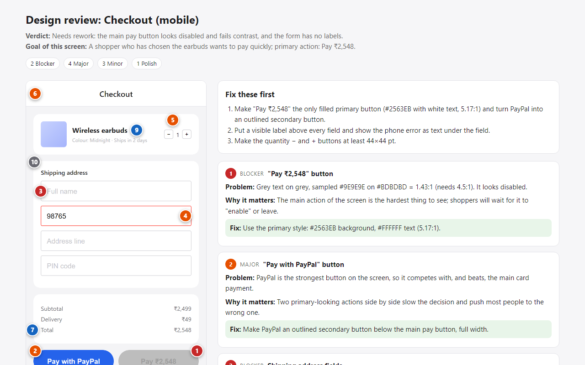

# Claude Code Skills & Plugins

**Website:** [wst2002.github.io/claude-code-skills](https://wst2002.github.io/claude-code-skills/)

Ready-to-use Claude Code skills and plugins that make AI coding agents faster,
more reliable, and honest about their work.

## Install

**Skills** — all of them, or pick one:

```bash
npx skills add WST2002/claude-code-skills
npx skills add WST2002/claude-code-skills --skill security-audit
```

Or copy any folder from [`skills/`](skills) into `~/.claude/skills/`
(Windows: `%USERPROFILE%\.claude\skills\`).

**Plugins** — inside Claude Code:

```
/plugin marketplace add WST2002/claude-code-skills
/plugin install issue-to-pr@claude-code-skills
/plugin install proof-of-done@claude-code-skills
```

## Plugins

| Plugin | What it does |
|---|---|
| [issue-to-pr](plugins/issue-to-pr) | `/fix-issue 123` — from a GitHub issue, Jira ticket or description to a tested fix and a draft pull request, in one command |
| [proof-of-done](plugins/proof-of-done) | Blocks the agent from finishing after code changes until tests, build or lint have passed after the last edit, and catches tests skipped, weakened or deleted to get there |


*proof-of-done in a real Claude Code session: Claude skipped the tests, the plugin made it run them, and they found a bug it had missed.* ▶ [Watch the 36-second demo on YouTube](https://youtube.com/shorts/ozlYRXQTs-U) · Featured on the [HOL blog](https://hol.org/blog/proof-of-done-checks-the-last-change)

📖 You can also read the story behind it on dev.to: [Your AI said "fixed" but never ran the tests? I made a plugin that won't let it say "done" until they pass](https://dev.to/wst2002rk/your-ai-said-fixed-but-never-ran-the-tests-i-made-a-plugin-that-wont-let-it-say-done-until-5531)

## Skills

### Code quality

| Skill | Use it to |
|---|---|
| [code-review](skills/code-review) | Review a PR, branch or diff for real defects, each with a concrete failing scenario |
| [bug-debugger](skills/bug-debugger) | Find the root cause of a bug, fix it, and prove the fix with a regression test |
| [test-writer](skills/test-writer) | Write tests that fail when behavior breaks, in your project's framework and style |
| [refactor-planner](skills/refactor-planner) | Refactor in small, safe, test-backed steps without changing behavior |
| [proof-of-done-lite](skills/proof-of-done-lite) | Make the agent show test and build results before saying "done" |

### Testing and QA

| Skill | Use it to |
|---|---|
| [test-case-generator](skills/test-case-generator) | Turn a requirement or user story into manual test cases: positive, negative, boundary, permission and state |
| [test-plan-writer](skills/test-plan-writer) | Write a risk-based test plan with scope, environments and measurable entry/exit criteria |
| [bug-report-writer](skills/bug-report-writer) | Write bug reports developers can reproduce on the first try |
| [playwright-e2e-tests](skills/playwright-e2e-tests) | Write reliable Playwright end-to-end tests with user-facing locators and no sleeps |
| [api-test-writer](skills/api-test-writer) | Write API tests for status codes, schemas, validation, auth and side effects |
| [flaky-test-fixer](skills/flaky-test-fixer) | Reproduce and fix tests that pass and fail without code changes |

### Everyday development

| Skill | Use it to |
|---|---|
| [codebase-onboarding](skills/codebase-onboarding) | Understand an unfamiliar codebase fast: how to run it, the map, one real request flow |
| [dependency-upgrade](skills/dependency-upgrade) | Upgrade packages and frameworks in safe steps, following migration guides |
| [changelog-writer](skills/changelog-writer) | Write release notes and pick the next version from git history |

### Security and performance

| Skill | Use it to |
|---|---|
| [security-audit](skills/security-audit) | Find exploitable vulnerabilities in any codebase, with file:line evidence, attack scenario and fix |
| [web-performance-audit](skills/web-performance-audit) | Find why a site is slow, tied to LCP, INP, CLS and bundle size, with expected gains |
| [accessibility-audit](skills/accessibility-audit) | Check keyboard, screen reader, contrast and ARIA issues mapped to WCAG 2.2 AA |
| [seo-audit](skills/seo-audit) | Make pages crawlable and indexable: meta tags, canonical, sitemap, structured data |

### UI/UX design

For designers too: these skills also work in the Claude app, with a screenshot,
a Figma frame or your research notes. No terminal needed:

1. Download the skill's ZIP from its page on the [website](https://wst2002.github.io/claude-code-skills/#skills).
2. In Claude, turn on **Code execution** (Settings → Capabilities).
3. Open **Customize → Skills**, click **+**, choose **Upload a skill** and pick the ZIP.



*design-review turns a screenshot into a shareable report: numbered pins on the screen, exact contrast
ratios measured from the pixels, and a concrete fix for each finding.
[Open the example report](https://wst2002.github.io/claude-code-skills/skills/design-review/examples/checkout-review.html).*

| Skill | Use it to |
|---|---|
| [design-review](skills/design-review) | Get senior-designer feedback on a screen: usability, hierarchy, accessibility and missing states, each with a concrete fix, as a report with numbered pins on the screenshot |
| [ux-research-synthesis](skills/ux-research-synthesis) | Turn interview notes and transcripts into findings with quotes, participant counts and "how might we" opportunities |
| [design-handoff-spec](skills/design-handoff-spec) | Write the developer handoff: every state, edge case, breakpoint and interaction, with open questions instead of guesses |
| [ux-writing](skills/ux-writing) | Write or review buttons, error messages, empty states and other UI text: clear, short and consistent |
| [figma-design-compare](skills/figma-design-compare) | Check a website, web app or mobile screen against its Figma frame: screenshots plus exact font, color, spacing and size values |

### Architecture

| Skill | Use it to |
|---|---|
| [database-schema-design](skills/database-schema-design) | Design a schema from scratch or review one for integrity, indexes and safe migrations |
| [api-design-review](skills/api-design-review) | Design or review REST APIs: naming, status codes, errors, pagination, breaking changes |
| [architecture-diagram](skills/architecture-diagram) | Draw system, sequence, ERD or deployment diagrams in Mermaid, from the real code |

### DevOps

| Skill | Use it to |
|---|---|
| [dockerize-app](skills/dockerize-app) | Write a small, secure Dockerfile and docker-compose for Node, Python, Java or Go, and verify it runs |
| [github-actions-ci](skills/github-actions-ci) | Set up or fix GitHub Actions CI with caching, services and least-privilege permissions |

### Writing

| Skill | Use it to |
|---|---|
| [git-commit-writer](skills/git-commit-writer) | Write commit messages that match your repo's convention and split mixed changes |
| [readme-writer](skills/readme-writer) | Write a README from the real codebase, with verified commands and nothing invented |
| [prd-writer](skills/prd-writer) | Write a PRD with evidence, measurable goals and testable acceptance criteria |

Every skill uses the same approach: a clear method, a fixed output format, and a
verification step so results are specific and low on false positives.

**Tested:** skills are benchmarked with and without the skill on sample projects
with seeded bugs and answer keys — see [benchmarks](benchmarks).

## Plugins vs skills

- **Skills** are instructions. Claude loads them when your request matches.
- **Plugins** can enforce behaviour with hooks, for example stopping the agent
  until checks pass.

## Contributing

See [CONTRIBUTING.md](CONTRIBUTING.md). Ideas for new skills are welcome as issues.

## License

MIT © Wageesha Tripathi

---

Made by **Wageesha Tripathi** · [LinkedIn](https://www.linkedin.com/in/wst2002/) · [Email](mailto:tripathiwageesha2002@gmail.com) · [YouTube](https://www.youtube.com/@wst2002rk)
