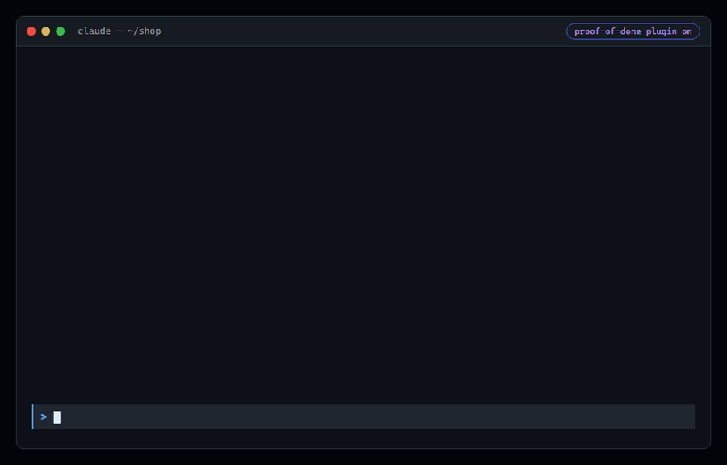

# proof-of-done

Stops Claude Code from ending its turn after changing code until verification has
run and passed after the last edit.



*A real Claude Code session, shortened: asked for a quick one-line fix, Claude said it
had not run the tests. proof-of-done blocked the stop, the tests ran, and one of them
found a bug Claude had missed.*

## How it works

1. Every code edit and every verification command (tests, build, lint, typecheck)
   is recorded for the session.
2. When the agent tries to stop:
   - no code edits → allowed
   - edits but no verification after the last edit → blocked, with the exact
     commands to run
   - the latest run of any check failed, was interrupted, or had its exit code
     hidden (`| tail`, `|| true`) → blocked, with the reason
   - a test run exited 0 but its summary shows 0 tests ran (every test
     skipped, or no test files found) → blocked
   - a check failed and then passed with no edit in between → flagged as flaky;
     blocked until the report says the check is flaky
   - test changes that make checks pass without a fix → blocked, with file and
     line: a test skipped or focused (`.skip`, `.only`, `@pytest.mark.skip`),
     an exact assertion swapped for a weak one (`toBe(250)` → `toBeDefined()`),
     an assertion that cannot fail (`expect(true)`, `assert True`), tests or test
     files deleted, errors hidden (`@ts-ignore`, `eslint-disable`, `# noqa`), or a
     coverage threshold lowered. A real, intended change is allowed when the report
     explains it on a line starting `Test changes:`
   - every check's latest run passed → allowed

Test summaries are read from node --test, Jest, Vitest, pytest, Cargo and Mocha
output. For other tools only the exit code counts. Test changes are read from
`git diff` against the commit the session started from, so committing a weakened
test does not hide it.

3. If verification is genuinely impossible, the agent can end with
   `Verification: skipped — <reason>` and say so honestly.

The agent is blocked at most once per stop attempt, so it can never loop forever.

## Install

```
/plugin marketplace add WST2002/claude-code-skills
/plugin install proof-of-done@claude-code-skills
```

## Commands

- `/proof` — show what was edited and verified in this session, and whether the
  gate would pass.

## Configuration (optional)

Create `.claude/proof-of-done.json` in your project:

```json
{
  "enabled": true,
  "verify": ["npm run lint", "npm test"],
  "ignore": ["generated/**", "*.snap"],
  "tamper": true
}
```

- `verify` replaces auto-detection.
- `ignore` adds file globs that never count as code edits.
- `tamper: false` turns off the test-change checks only.
- `enabled: false` turns the gate off for this project.

Auto-detection covers npm/pnpm/yarn/bun scripts (`typecheck`, `lint`, `test`,
`build`), pytest, Go, Cargo, Maven and Gradle.

## Requirements

Node.js 18 or newer on your `PATH`.

---

Made by **Wageesha Tripathi** · [LinkedIn](https://www.linkedin.com/in/wst2002/) · [Email](mailto:tripathiwageesha2002@gmail.com) · [More skills](https://github.com/WST2002/claude-code-skills)
