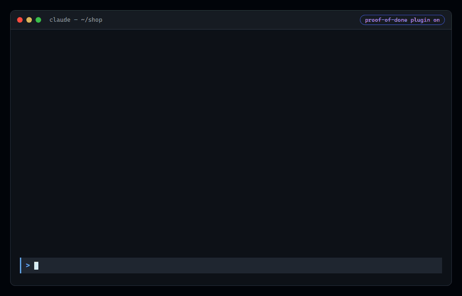

# proof-of-done

Stops Claude Code from ending its turn after changing code until verification has
run and passed after the last edit.



*A real Claude Code session, shortened: asked for a quick one-line fix, Claude said it
had not run the tests. proof-of-done blocked the stop, the tests ran, and one of them
found a bug Claude had missed.*

▶ [Watch the 36-second demo on YouTube](https://youtube.com/shorts/ozlYRXQTs-U) · Featured on the [HOL blog](https://hol.org/blog/proof-of-done-checks-the-last-change)

📖 You can also read the story behind it on dev.to: [Your AI said "fixed" but never ran the tests? I made a plugin that won't let it say "done" until they pass](https://dev.to/wst2002rk/your-ai-said-fixed-but-never-ran-the-tests-i-made-a-plugin-that-wont-let-it-say-done-until-5531) · Also on Reddit: [r/coolgithubprojects](https://www.reddit.com/r/coolgithubprojects/comments/1xakl8x/javascript_proofofdone_a_claude_code_plugin_that/)

## How it works

1. Every code edit and every verification command (tests, build, lint, typecheck)
   is recorded for the session.
2. When the agent tries to stop:
   - no code edits → allowed
   - edits but no verification after the last edit → blocked, with the exact
     commands to run
   - the latest run of any check failed, was interrupted, or had its exit code
     hidden (`| tail`, `|| true`) → blocked, with the reason
   - a test run exited 0 but its summary shows 0 tests ran (every test
     skipped, or no test files found, including `go test` packages with
     `[no test files]` and Jest/Vitest `--passWithNoTests`) → blocked
   - a check failed before the last edit and has not run since → blocked until
     it runs again, so a passing lint cannot clear a failing test
   - monorepo: a changed package has its own `test` script, but no passing run
     after its last edit covered it (a root `npm test` that only runs another
     workspace) → blocked, with the command for that package
     (`npm test -w packages/api`, `pnpm --filter api test`,
     `yarn workspace api test`)
   - a check failed and then passed with no edit in between → flagged as flaky;
     blocked until the report says the check is flaky
   - test changes that make checks pass without a fix → blocked, with file and
     line: a test skipped or focused (`.skip`, `.only`, `@pytest.mark.skip`),
     an exact assertion swapped for a weak one (`toBe(250)` → `toBeDefined()`),
     an assertion that cannot fail (`expect(true)`, `assert True`), tests or test
     files deleted, errors hidden (`@ts-ignore`, `eslint-disable`, `# noqa`), or a
     coverage threshold lowered. A real, intended change is allowed when the report
     explains it on a line starting `Test changes:`
   - new code but no test added or changed in the session (a new code file of
     5+ lines, or 20+ changed lines in all) → Claude asks you once whether to
     add a test. Say yes and it writes and runs one; say no and it notes
     `No new tests: <reason>` in its report. It never asks twice about the same
     files. Small edits, styles, markup, config, docs and scripts are left alone.
   - your tests wrote a coverage report after the last edit, and it shows changed
     lines that never ran in any test → Claude asks you once whether to add tests
     that run them (or, in strict mode, keeps blocking until they run or the
     report explains on a line starting `Uncovered lines:`). It names each file
     and the lines, like `src/price.js (lines 4–5)`
   - every check's latest run passed → allowed

Test summaries are read from node --test, Jest, Vitest, pytest, Cargo and Mocha
output. For other tools only the exit code counts. Test changes are read from
`git diff` against the commit the session started from, so committing a weakened
test does not hide it. Missing tests are found the same way, so both checks need a
git repository.

Monorepos are found from npm, yarn and bun `workspaces` and
`pnpm-workspace.yaml`. A test run covers a package when it ran inside the
package folder (`cd packages/api && npm test` too), named it (`-w`,
`--workspace`, `--filter`, `--prefix`, `yarn workspace`, turbo `--filter`,
`nx test api`, lerna `--scope`), or ran every workspace (`--workspaces`, `-r`,
turbo, `nx run-many`, `nx affected`, `lerna run`, `bun test`). A plain root run
covers what the tests in the root script cover, and a package's tests also count
for the packages nested inside it (test apps, examples). Test runners started
through a package manager count too (`pnpm vitest`, `yarn jest`, `pnpm exec`,
`bunx`, `pnpm turbo`, `pnpm nx`, `nx run api:test`). Lint, typecheck and build runs do not count as
running a package's tests. When the target cannot be worked out (dependency
filters like `api...`, a command from `verify` or a script step it cannot read,
a folder the command moved to that cannot be known), the run counts for every
package, so the gate never blocks on a guess.

3. If verification is genuinely impossible, the agent can end with
   `Verification: skipped — <reason>` and say so honestly.

The agent is blocked at most once per stop attempt, so it can never loop forever.

## Install

```
/plugin marketplace add WST2002/claude-code-skills
/plugin install proof-of-done@claude-code-skills
```

## Commands

- `/proof` — show what was edited and verified in this session, and whether the
  gate would pass.

## Configuration (optional)

Create `.claude/proof-of-done.json` in your project:

```json
{
  "enabled": true,
  "verify": ["npm run lint", "npm test"],
  "ignore": ["generated/**", "*.snap"],
  "tamper": true,
  "tests": "ask",
  "coverage": "ask",
  "workspaces": true
}
```

- `verify` replaces auto-detection.
- `ignore` adds file globs that never count as code edits.
- `tamper: false` turns off the test-change checks only.
- `tests` decides what happens when code changes with no test: `"ask"` (default)
  asks you once, `"strict"` blocks until a test is added or the report gives a
  `No new tests:` reason, `"off"` never asks.
- `coverage` decides what happens when a fresh coverage report shows changed
  lines that never ran: `"ask"` (default) asks you once per file, `"strict"`
  blocks until they run or the report gives an `Uncovered lines:` reason,
  `"off"` never checks. The plugin never runs coverage itself: it reads
  `coverage/lcov.info` (Jest, Vitest, c8, nyc, node), `coverage/coverage-final.json`
  (Istanbul) or `coverage.xml` (coverage.py, pytest-cov) when your test run wrote
  one after the last edit.
- `workspaces: false` turns off the monorepo package check, so any passing
  run after the last edit counts for every package.
- `enabled: false` turns the gate off for this project.

Auto-detection covers npm/pnpm/yarn/bun scripts (`typecheck`, `lint`, `test`,
`build`), pytest, Go, Cargo, Maven and Gradle.

## Requirements

Node.js 18 or newer on your `PATH`.

---

Made by **Wageesha Tripathi** · [LinkedIn](https://www.linkedin.com/in/wst2002/) · [Email](mailto:tripathiwageesha2002@gmail.com) · [More skills](https://github.com/WST2002/claude-code-skills) · [YouTube](https://www.youtube.com/@wst2002rk)
